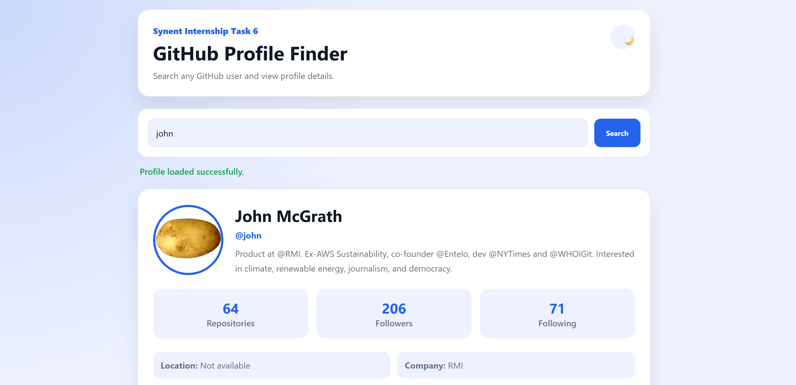

# GitHub Profile Finder

[](https://jad-obeidd.github.io/synent-task6-githubapi-jadobeid/)

A responsive web application that searches public GitHub profiles and displays useful account and repository information through the GitHub REST API. Built during my Synent Technologies Web Development Internship.



## Features

- Search by GitHub username
- Display avatar, name, username, biography, and join date
- Show followers, following, and public repository counts
- Display company, location, website, and recent repositories
- Show repository languages, stars, and forks
- Loading and error states
- Dark and light themes
- Responsive mobile and desktop interface

## Built With

- HTML5
- CSS3
- Vanilla JavaScript
- Fetch API
- [GitHub REST API](https://docs.github.com/en/rest)

## Run Locally

```bash
git clone https://github.com/jad-obeidd/synent-task6-githubapi-jadobeid.git
cd synent-task6-githubapi-jadobeid
```

Open `index.html` in your browser. No API key, installation, or build step is required.

> GitHub applies rate limits to unauthenticated API requests.

## Project Structure

```text
.
├── index.html
├── style.css
└── script.js
```

## Live Demo

[jad-obeidd.github.io/synent-task6-githubapi-jadobeid](https://jad-obeidd.github.io/synent-task6-githubapi-jadobeid/)

## Possible Improvements

- Repository filtering and pagination
- Favorite profiles
- Recent-search history
- Organization information

## Author

**Jad Obeid**  
[GitHub](https://github.com/jad-obeidd) · [LinkedIn](https://www.linkedin.com/in/jad-obeid-dev)

## Note

Created for educational and internship purposes.
